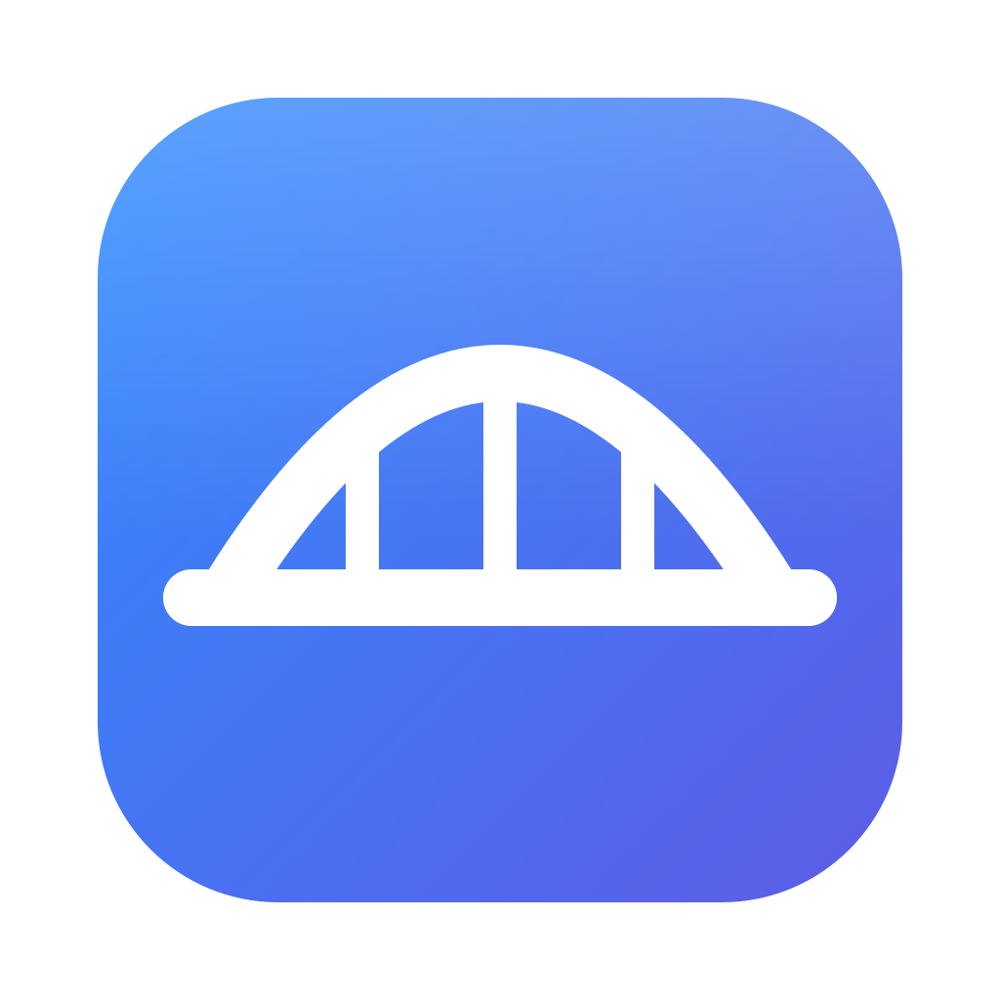

# Bridg

**Your Android phone, on your Mac and your PC** — open source, MIT-licensed screen mirroring, file transfer, clipboard sync, and notification forwarding between Android phones and Macs, plus a Windows app (beta).

Built on proven capture approaches (inspired by scrcpy) with a custom protobuf-based transport layer and end-to-end encryption.

## Features

- **Pairing**: One-time QR code pairing with X25519 key exchange, auto-reconnect
- **Several computers, several phones**: One phone stays connected to a Mac and a Windows PC at once, and a computer takes several phones at once; notifications and clipboard reach all of them, and a copy on one device can be pasted on another
- **Devices**: Every app shows the whole ecosystem: this device, its links, and the devices those report (platform, OS, model, app version, battery)
- **File Transfer**: Drag-and-drop files between devices, SHA-256 verified
- **Notifications**: Phone notifications appear natively on Mac, with reply support
- **Clipboard Sync**: Copy on one device, paste on the other
- **Calls**: Answer or decline incoming calls from the Mac, or start one from the menu bar (dialling needs the phone paired with the Mac in System Settings → Bluetooth). The conversation itself stays on the phone (or earbuds paired to it): Android blocks apps from carrying call audio, and macOS refuses to open Bluetooth call audio as a hands-free device — tested in [docs/HANDSFREE_PLAN.md](docs/HANDSFREE_PLAN.md)
- **Phone Battery**: Level and charging state in the Mac menu bar
- **Ring Phone**: Find a silenced phone from the Mac
- **Open Links on Phone**: Push the link you just copied straight to the phone
- **Screen Mirroring**: Live phone screen on your Mac with low latency
- **Input Control**: Click, type, and gesture on your phone from Mac

## Architecture

```
bridg/
├── android/        # Kotlin Android app (Gradle)
├── mac/            # Swift macOS app
├── desktop/        # Windows app (Rust + Tauri), beta
├── proto/          # Shared protobuf protocol definitions
└── docs/           # Protocol docs, design notes
```

## Getting Started

### Prerequisites

- Android Studio (latest stable), building with **JDK 17 or 21** (JDK 24+ is not
  supported by this project's Gradle/AGP — see [RUNNING.md](RUNNING.md))
- Xcode 15+ with macOS 13+ deployment target
- protobuf compiler (`protoc`) or buf CLI

### Build

**Android:**
```bash
cd android
./gradlew assembleDebug                 # build the APK
./gradlew installDebug                   # build + install on a connected device (adb)
```

The APK lands at `android/app/build/outputs/apk/debug/app-debug.apk` — install
it directly with `adb install -r app/build/outputs/apk/debug/app-debug.apk`, or
send that file to the phone and open it (enable "Install unknown apps").

**Mac:**
```bash
./mac/make_app.sh
open mac/build/Bridg.app
```

`swift build` alone produces a bare binary with no bundle identifier, which
macOS refuses to grant Local Network access and which crashes on first use of
the notification centre. `make_app.sh` wraps the build into `Bridg.app`.

**Step-by-step setup, including pairing and permissions:
see [RUNNING.md](RUNNING.md).**

### Windows (beta)

Download `Bridg_x.y.z_x64-setup.exe` from the [latest release](https://github.com/HardikShreays/Bridg/releases/latest),
run it, and scan the QR code it shows with Bridg on the phone.

- Works today: pairing, reconnect, notifications (with reply), call answer/decline,
  clipboard both ways (text), files both ways (drop files on the window),
  battery, media controls, ring phone, open links on the phone.
- Not yet: screen mirroring and input control.
- The installer is not code-signed yet, so SmartScreen warns on first run
  (*More info → Run anyway*). Windows Firewall then asks whether Bridg may use
  the network: allow **Private networks**, or the phone cannot connect.
- Closing the window keeps Bridg running in the tray, so the phone stays connected.

Build it with Rust and Node installed:
```bash
cd desktop/src-tauri
cargo test                          # protocol tests, pinned to the Mac/Android vectors
npx @tauri-apps/cli@2 build         # installer in target/release/bundle/nsis/
```

### Protocol

See [docs/PROTOCOL.md](docs/PROTOCOL.md) for the wire protocol specification.

## Development Phases

1. **Phase 1** — Pairing, Transport, File Transfer
2. **Phase 2** — Notifications, Clipboard Sync
3. **Phase 3** — Screen Mirroring + Input Control
4. **Phase 4** — Polish and parity features

## Security

- All communication encrypted with ChaCha20-Poly1305 (via libsodium)
- X25519 key exchange during QR pairing
- Device identity stored in Android EncryptedSharedPreferences / macOS Keychain
- No data leaves your local network

## Support

If you find Bridg useful, you can [buy me a coffee](https://buymeacoffee.com/hardikshreyas).

## License

MIT — see [LICENSE](LICENSE) for details.
